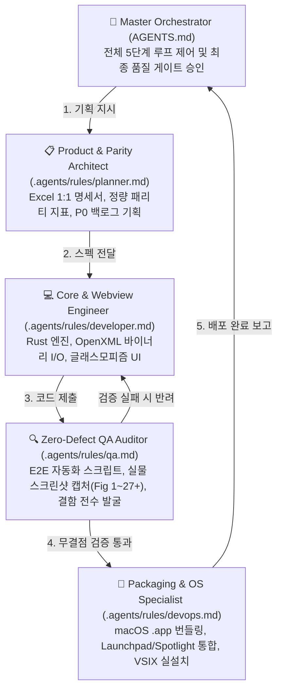

# OPEN_EXCELL / GridCraft — Master Agent Orchestrator & Multi-Agent Architecture

> **PROJECT**: OPEN_EXCELL (Cross-Platform Native Spreadsheet & VS Code Extension)  
> **REMOTE REPO**: https://github.com/iamywl/OPEN_EXCELL.git  
> **PLATFORMS**: macOS (Apple Silicon & Intel), Windows 10/11 (x64, ARM64), Linux  
> **DESIGN PHILOSOPHY**: **Ultra Glassmorphism / Frosted Liquid Glass** (Ambient mesh gradient, 28px backdrop blur, emerald neon accents, floating glass islands & pills)  
> **ROLE**: **Master Orchestrator (총괄 조율 및 루프 제어)**  

---

## 🏛️ 5대 전문 에이전트 분업 아키텍처 (Multi-Agent System)

본 프로젝트는 기획-개발-QA-배포 간의 **상호 견제(Separation of Concerns)**와 **무결점 품질 게이트**를 달성하기 위해 5대 전문 에이전트 파일로 분할 관리된다:

| 에이전트 | 전담 파일 | 주요 역할 및 담당 산출물 |
| :--- | :--- | :--- |
| **Master Orchestrator** | [`AGENTS.md`](./AGENTS.md) | 전체 루프 오케스트레이션, 단계별 게이트 통과 여부 최종 승인, 전수 문서화 총괄 |
| **Product & Parity Architect** | [`.agents/rules/planner.md`](./.agents/rules/planner.md) | Excel 7대 영역 1:1 기능명세서(`EXCEL_SPECIFICATION.md`), P0 우선순위, 패리티율(%) 산출 |
| **Core & Webview Engineer** | [`.agents/rules/developer.md`](./.agents/rules/developer.md) | Rust 네이티브 엔진(`crates/*`), VS Code Extension(`extension/*`), Undo/Redo, OpenXML I/O |
| **Zero-Defect QA Auditor** | [`.agents/rules/qa.md`](./.agents/rules/qa.md) | 독립적 품질 감사, E2E Puppeteer 테스트, 실물 캡처 증명(`QA_PROOF.md`, Fig 1~27+) |
| **Packaging & OS Specialist** | [`.agents/rules/devops.md`](./.agents/rules/devops.md) | macOS `.app` 번들링, Launchpad/Spotlight 통합, VSIX 로컬 실설치, 프로세스 생명주기 관리 |

---

## ⭐️ [핵심 기본 철학] 엑셀 기능의 VS Code 완전 내장 (Excel Parity in VS Code)
**"단순한 파일 뷰어나 간이 테이블이 아니라, Microsoft Excel의 핵심 기능 일체(풀 리본 툴바, 셀 포맷, 테두리, 수식 엔진, 행/열 리사이즈, 셀 병합, 필터/정렬, 다중 시트, 단축키, 바이너리 저장 등)를 VS Code 익스텐션 내에 온전히 구현하여 완벽한 엑셀 작업 환경을 제공하는 것이 본 프로젝트의 최우선 불변 철학이다."**

1. **완전한 엑셀 사용자 경험**:
   - 상단 리본바 탭 체계 (Home, Insert, Formulas, Data, View) 완비
   - 폰트(글꼴 패밀리, 크기), 글꼴색/배경색(컬러 피커), 테두리(Borders), 정렬(수직/수평), 텍스트 줄바꿈(Wrap Text), 셀 병합(Merge & Center)
   - 숫자 서식 드롭다운 (일반, 숫자, 통화, 회계, 백분율, 날짜, 지수)
   - 엑셀 표준 수식 바 (Name Box + fx 수식 입력 + 셀 양방향 반응형 바인딩)
   - 스프레드시트 그리드 인터랙션:
     - 마우스 드래그 다중 셀 범위 선택 (Range Selection: `A1:C5`)
     - 셀 우하단 자동 채우기 핸들 (Auto Fill Drag Handle)
     - 행 높이 / 열 너비 마우스 드래그 리사이징
     - 컨텍스트 메뉴 (행/열 삽입, 삭제, 복사, 잘라내기, 붙여넣기)
     - 엑셀 표준 단축키: `Ctrl/Cmd+C`, `Ctrl/Cmd+V`, `Ctrl/Cmd+X`, `Ctrl/Cmd+Z`, `Ctrl/Cmd+Y`, `Ctrl/Cmd+B`, `Ctrl/Cmd+I`, `Ctrl/Cmd+U`, `Delete`
   - 표준 바이너리 `.xlsx` (OpenXML) 무손실 읽기 및 쓰기 저장
2. **크로스 플랫폼 네이티브 연동**:
   - macOS(Metal) 및 Windows(DirectX) 초고속 네이티브 데스크톱 앱과의 원클릭 양방향 연동

---

## 🔄 Master Loop Engineering Protocol (5단계 루프 엔지니어링)

모든 작업은 Master Orchestrator의 지휘 아래 다음 5단계 루프와 품질 게이트를 순차 통과해야 한다:

1. **[Phase 1: Requirement & Planning Gate]** *(전담: Product & Parity Architect)*
   - `docs/EXCEL_SPECIFICATION.md`의 기능명세서 기반 P0 작업 범위 설정.
   - 1줄짜리 placeholder 방지 및 허위 기재 없는 정량적 패리티 지표 갱신.
2. **[Phase 2: Implementation & Engineering Gate]** *(전담: Core & Webview Engineer)*
   - `extension/web/grid.js`, `grid.css`, `editorProvider.ts` 및 Rust engine 구현.
   - Ultra Glassmorphism 테마(28px 블러, 네온 에메랄드) 및 WCAG AA 가독성 준수.
   - 모든 조작 즉시 `pushHistory()` (Undo/Redo) 및 OpenXML `!cols`, `!rows`, `!merges` 바이너리 직렬화 보장.
3. **[Phase 3: Independent QA & Proof of Capture Gate]** *(전담: Zero-Defect QA Auditor)*
   - 개발 코드 독립 감사: 껍데기 UI 및 더미 함수 적발 시 반려.
   - Puppeteer E2E 자동화 스크립트 실행 및 실물 스크린샷 캡처(Fig 1 ~ Fig 27+).
   - `docs/QA_PROOF.md` 및 `docs/AUDIT_AND_IMPROVEMENT_REPORT.md` 실시간 업데이트.
4. **[Phase 4: Packaging & OS Delivery Gate]** *(전담: Packaging & OS Specialist)*
   - 정식 macOS App Bundle (`/Applications/OPEN_EXCELL.app`, `GridCraft.app`) 패키징.
   - 고유 Bundle ID 검증, `codesign`, `lsregister`, `killall Dock` 실행으로 Launchpad/Spotlight 등록.
   - `open-excell-1.0.0.vsix` 패키징 및 VS Code 로컬 실설치 검증 (`code --install-extension --force`).
   - 테스트 완료 후 좀비 백그라운드 프로세스 정리.
5. **[Phase 5: Master Sync & Final Delivery Gate]** *(전담: Master Orchestrator)*
   - 4대 문서(`README.md`, `EXCEL_SPECIFICATION.md`, `QA_PROOF.md`, `AUDIT_AND_IMPROVEMENT_REPORT.md`) 100% 동기화 검증.
   - `git add`, `git commit`, `git push origin main` 원격 저장소 동기화 및 사용자 종합 보고.

---

# GridCraft — Base Architecture & Clean-room Rules

GridCraft is a clean-room, open-source, Rust-native spreadsheet targeting Microsoft Excel parity — and superiority (speed, openness, agent control). It runs natively on macOS, Windows, Linux and BSD, and on the web via WASM.

## Assets and iconography — absolute rule
**No Microsoft, Adobe, Avid, Autodesk (or any other vendor's) iconography, images, artwork, fonts, templates, themes or sample files — ever.** This is the most important rule in this repository; breaking it is a serious failure.
- Every asset in the repo is original work by GridCraft contributors, or public domain / CC0, or open source / Creative Commons that allows redistribution.
- Every asset file has a row in [`ATTRIBUTION.md`](ATTRIBUTION.md).
- Prefer art generated in code: the UI icon set (`crates/ui-egui/src/icons.rs`).

## Never crash
People trust GridCraft with their numbers; a crash loses their work. **This outranks feature work.** Standard: `craftrules/standards/never-crash.md`.
- **No panics in non-test code:** no `unwrap()`, `expect()`, `panic!`, `unreachable!`, `todo!`, `unimplemented!`; no `unsafe` (`unsafe_code = "forbid"`).
- **Errors are `Result<T, E>`** through the crate's error type and `?`.
- **Input-derived numbers are hostile**: `get()` instead of indexing, checked/saturating arithmetic, cap input-sized allocations.
- Crates carry `#![deny(clippy::unwrap_used, clippy::expect_used, clippy::panic, clippy::unimplemented, clippy::todo, clippy::unreachable)]`.

## Running and looking at the app
- Run sample native app: `cargo run --release -p gridcraft -- --sample sales --control 7979`
- Offscreen snapshot: `cargo run -p gridcraft-ui-egui --example snapshot -- --sample sales out.png`
- Installed macOS App: `open /Applications/OPEN_EXCELL.app`
- VS Code Extension: `code --install-extension open-excell-1.0.0.vsix --force`
