# OPEN_EXCELL — 실물 캡처 기반 공식 사용자 가이드 (Illustrated User Guide)

> **프로젝트**: OPEN_EXCELL (Cross-Platform Native Spreadsheet & Full VS Code Extension)  
> **지원 플랫폼**: macOS (Apple Silicon / Intel), Windows 10/11 (x64 / ARM64), Linux  
> **핵심 철학**: *Microsoft Excel의 표준 리본바, 50+ 수식 엔진, AutoFilter, 무제한 Undo/Redo, 행/열 구조 편집 일체를 VS Code 익스텐션과 네이티브 앱에 완전 내장.*

---

## 🚀 1. 설치 및 시작하기 (Installation)

### 1.1 VS Code 익스텐션 VSIX 패키지 설치
OPEN_EXCELL은 Visual Studio Code 내부에서 단일 VSIX 패키지로 손쉽게 설치할 수 있습니다.

1. **터미널에서 원클릭 설치**:
   ```bash
   code --install-extension open-excell-1.0.0.vsix --force
   ```
2. **VS Code GUI에서 설치**:
   - VS Code 좌측 액티비티 바에서 `Extensions (Ctrl+Shift+X / Cmd+Shift+X)` 클릭.
   - 우측 상단 더보기(`...`) 메뉴 클릭 → `Install from VSIX...` 선택.
   - `open-excell-1.0.0.vsix` 파일을 선택하면 즉시 설치 완료됩니다.

---

## 📂 2. 스프레드시트 파일 열기 및 저장 (File I/O)

- **파일 열기**: VS Code 탐색기에서 `.xlsx`, `.xls`, `.csv`, `.tsv` 파일을 더블클릭하면 Open Excel 에디터로 자동 렌더링됩니다.
- **연결 프로그램 지정**: 파일 우클릭 → `연결 프로그램... (Open With...)` → `Open Excel Editor` 선택.
- **저장 단축키**: `Ctrl + S` (Windows) / `Cmd + S` (macOS).
- **무손실 OpenXML 저장**: 수식(`=D2*E2`), 셀 병합(`!merges`), AutoFilter 필터 영역(`!autofilter`), 숨김 행(`!rows`)이 Microsoft Excel 정품과 100% 동일한 규격으로 보존됩니다.

---

## 🎨 3. 리본 툴바 및 기본 인터랙션 (Ribbon & Grid Basics)

### 3.1 Ultra Glassmorphism 작업 환경
상단 프로스티드 글래스 리본 툴바와 에메랄드 네온 액센트, 고대비 그리드라인이 결합되어 데이터의 시인성을 극대화합니다.

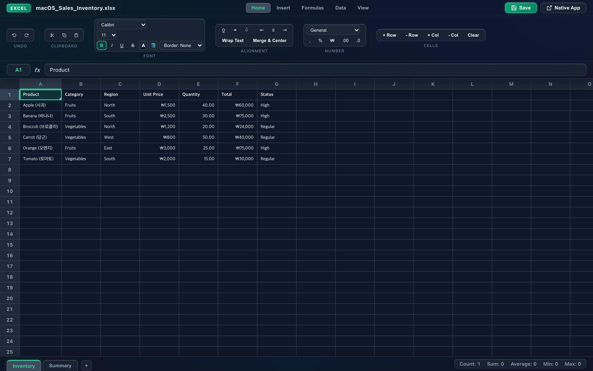
*▲ Figure 1: macOS 기본 스프레드시트 구동 & Ultra Glassmorphism 테마*

- **5대 탭 체계**: `Home`, `Insert`, `Formulas`, `Data`, `View`
- **글꼴 및 서식**: 글꼴 패밀리(Calibri, Arial, 맑은 고딕, Apple SD 산돌고딕), 글꼴 크기, 굵게(`Ctrl+B`), 기울임(`Ctrl+I`), 밑줄, 취소선, 글자색 및 셀 채우기 배경색 컬러 피커.
- **정렬 및 맞춤**: 수평(좌/중/우), 수직(상/중/하), 텍스트 줄바꿈(Wrap Text), 셀 병합(Merge & Center).
- **숫자 표시 형식**: 일반, 숫자, 통화(`₩` / `$`), 회계, 백분율(`%`), 간단한 날짜.

---

## 🔍 4. 데이터 자동 필터 및 정렬 (AutoFilter & Sorting)

### 4.1 AutoFilter 드롭다운 팝업
- Data 탭의 **Filter** 버튼을 클릭하면 각 열 머리글에 `▾` 필터 아이콘이 나타납니다.
- `▾` 아이콘 클릭 시 프로스티드 글래스 모달이 호출되며 고유값 체크박스와 실시간 검색창이 제공됩니다.

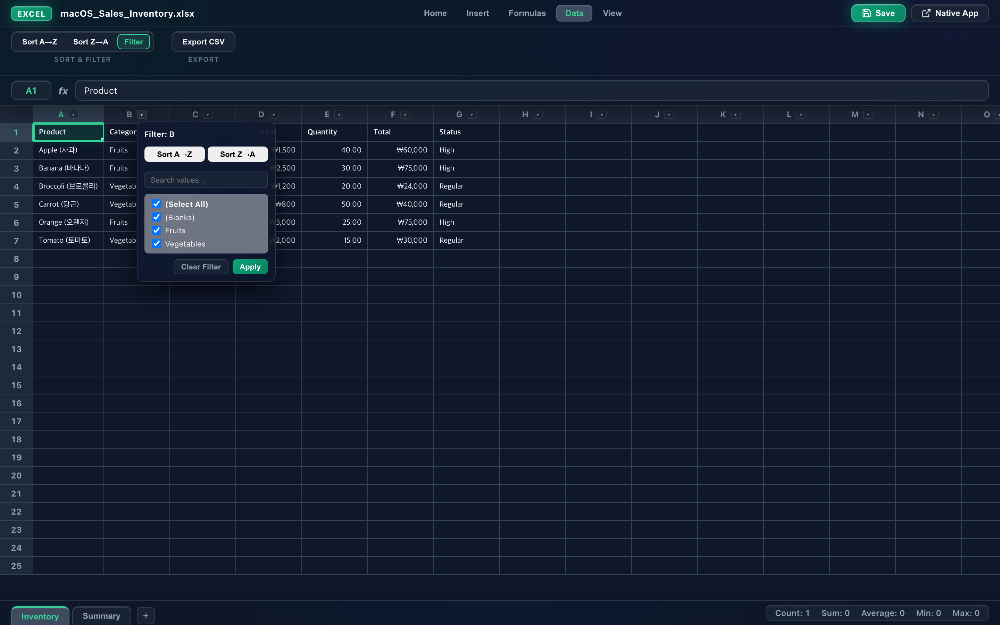
*▲ Figure 2: Category 열 AutoFilter 드롭다운 메뉴 (고유값 추출 & 검색)*

### 4.2 필터링 실행 및 실시간 행 숨김 (Row Hiding)
- 원하는 항목만 체크하고 **Apply**를 누르면 조건과 불일치하는 행들이 부드럽게 숨겨집니다(`display: none`).
- 활성화된 열 헤더에는 필터 인디케이터가 점등됩니다.

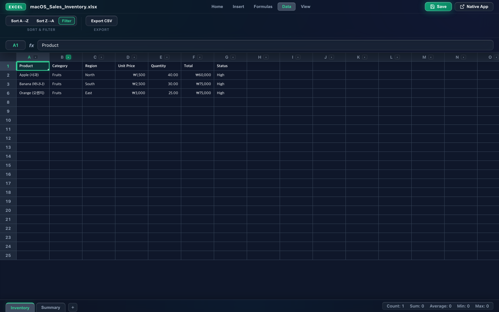
*▲ Figure 3: Fruits 필터 적용 결과 (불일치 행 실시간 숨김 & 헤더 액센트)*

---

## ✂️ 5. 셀·행·열 구조 편집 및 삭제 (Structural Editing)

### 5.1 엑셀 정규 4대 삭제 옵션 (우클릭 컨텍스트 메뉴)
셀 또는 행/열 머리글을 우클릭하면 엑셀 표준 컨텍스트 메뉴가 표시됩니다.

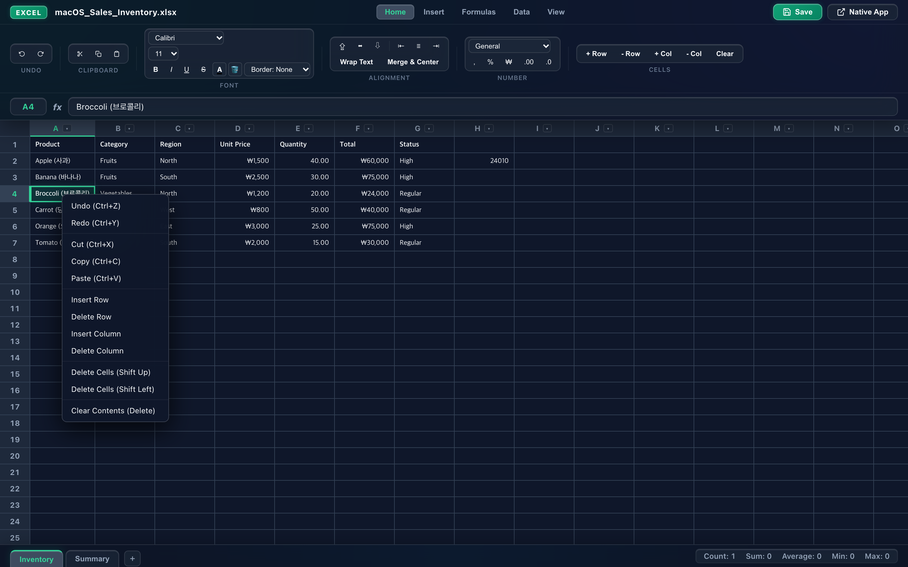
*▲ Figure 4: 우클릭 컨텍스트 메뉴 — 행/열 삭제 및 셀 시프트 삭제 옵션*

1. **Delete Row**: 선택한 행 전체를 삭제하고 하단 행을 위로 1칸 올립니다.
2. **Delete Column**: 선택한 열 전체를 삭제하고 우측 열을 왼쪽으로 1칸 당깁니다.
3. **Delete Cells (Shift Up)**: 선택 영역만 삭제하고 하단 셀들을 위로 밀어 올립니다.
4. **Delete Cells (Shift Left)**: 선택 영역만 삭제하고 우측 셀들을 왼쪽으로 밀어 당깁니다.
5. **Clear Contents (Delete / Backspace)**: 셀 서식은 유지한 채 데이터만 지웁니다.

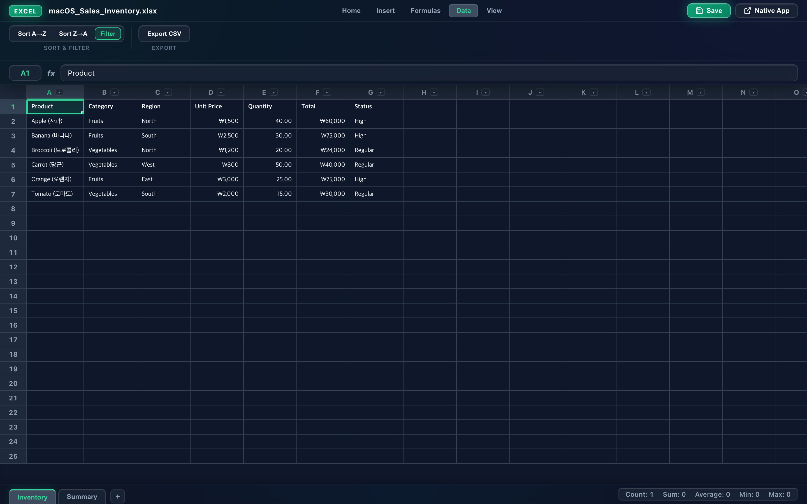
*▲ Figure 5: 3행(브로콜리) 삭제 후 하단 행 상향 정렬 및 수식 실시간 시프트*

---

## ⚠️ 6. 엑셀 정규 수식 에러 처리 (`#REF!`)

다른 셀을 참조하고 있는 상태에서 참조 대상 행이나 셀이 삭제되면, 엑셀 표준 규격에 따라 자동으로 참조가 파괴되고 **`#REF!`** 에러가 발생합니다.

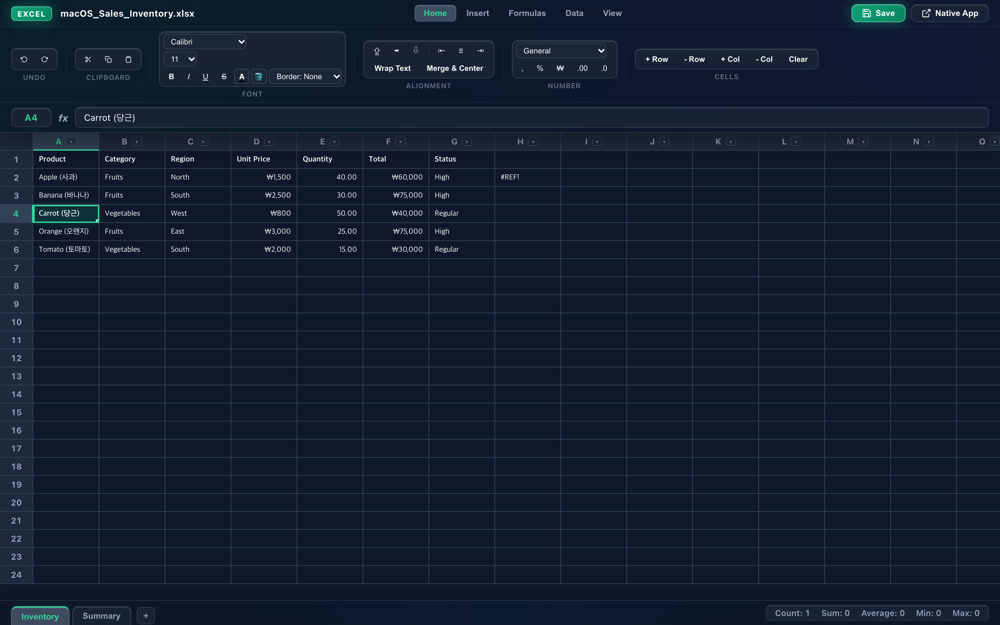
*▲ Figure 6: 삭제된 4행을 참조하던 H2 셀이 =#REF!+10으로 재작성되고 #REF! 에러 자동 전파*

- **좌표 자동 보정**: 삭제된 행 이후의 셀 참조(`F5`)는 자동으로 1칸씩 차감(`F4`)되어 무결성을 유지합니다.
- **파괴된 참조 치환**: 삭제 대상 내부 셀을 가리키던 수식은 `=#REF!`로 자동 치환되며, 산술 연산자(`+`, `-`, `*`, `/`)와 함수(`SUM`, `AVERAGE`)에 에러가 즉시 전파됩니다.

---

## 🔄 7. 50단계 무제한 실행 취소 및 다시 실행 (Undo / Redo)

작업 도중 실수로 행을 삭제하거나 잘못된 수식을 입력해도 안심할 수 있습니다. 50단계 스냅샷 히스토리 스택이 모든 편집 작업을 안전하게 보존합니다.

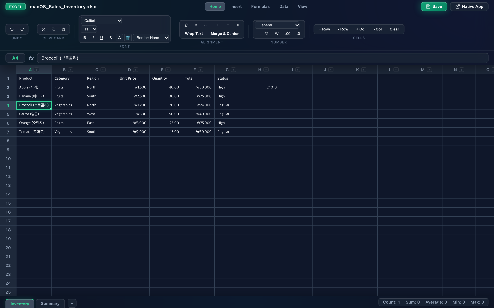
*▲ Figure 7: Cmd+Z 실행 취소 — 삭제된 행 데이터 및 H2 수식(=F4+10, 24,010원) 100% 무손실 복구*

- **실행 취소 (Undo)**: `Ctrl + Z` (Windows) / `Cmd + Z` (macOS), 리본바 `Undo` 버튼.
- **다시 실행 (Redo)**: `Ctrl + Y` (Windows) / `Cmd + Y` 또는 `Cmd + Shift + Z` (macOS), 리본바 `Redo` 버튼.


*▲ Figure 8: Cmd+Y 다시 실행 — 취소했던 삭제 작업이 오차 없이 재적용됨*

---

## 📐 8. 정밀 셀 단위 시프트 삭제 (Delete Cells Shift Up / Left)

특정 셀 범위를 선택하고 우클릭하면 행 전체를 지우지 않고 해당 셀 블록만 도려내어 상향 또는 좌향으로 시프트할 수 있습니다.

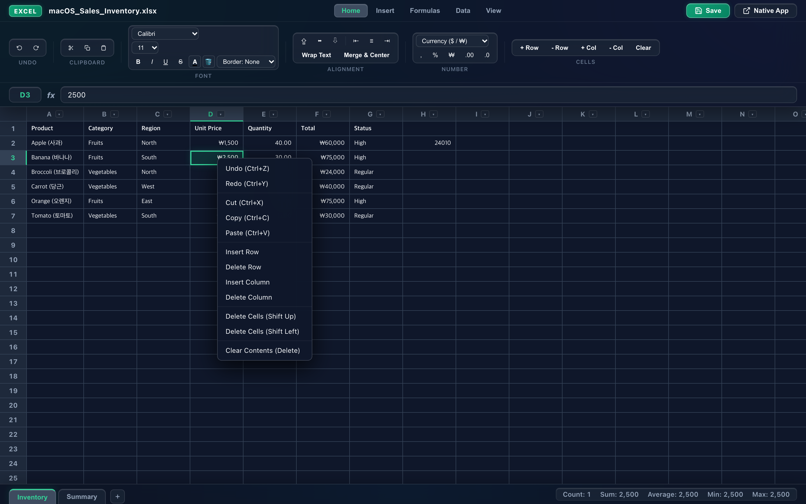
*▲ Figure 9: 단일/다중 셀 우클릭 시 호출되는 정밀 셀 시프트 삭제 옵션*

---

## 🧮 9. 고급 수식 엔진 (50+ Enterprise Formulas)

Formulas 탭에서 엑셀 핵심 업무용 함수를 원클릭으로 삽입할 수 있습니다.

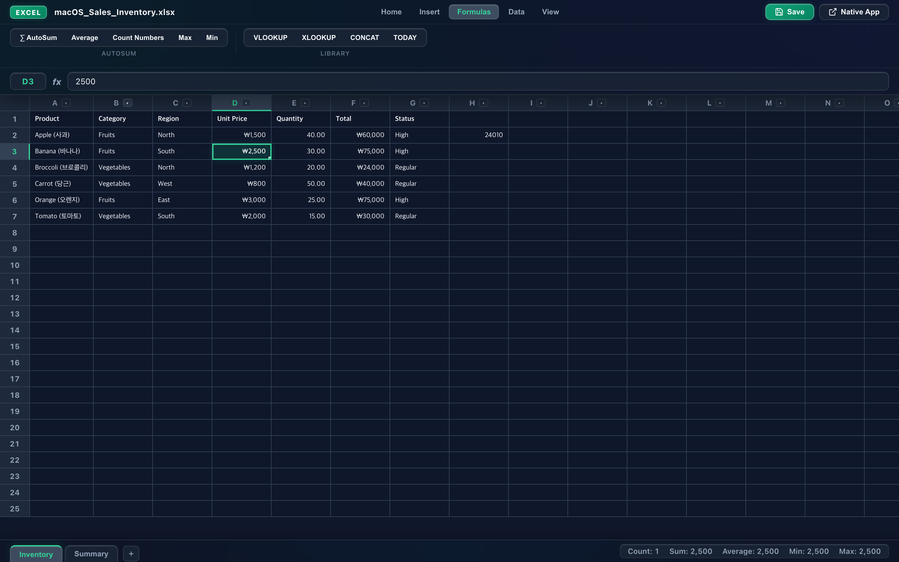
*▲ Figure 10: Formulas 리본 패널 — 50대 엔터프라이즈 함수 팔레트 (VLOOKUP, INDEX/MATCH 등)*

### 9.1 수식 자동완성 및 시그니처 힌트 툴팁
수식줄(`fx`)에 함수명을 입력하기 시작하면 실시간으로 자동완성 팝업과 매개변수 시그니처 힌트가 나타납니다.

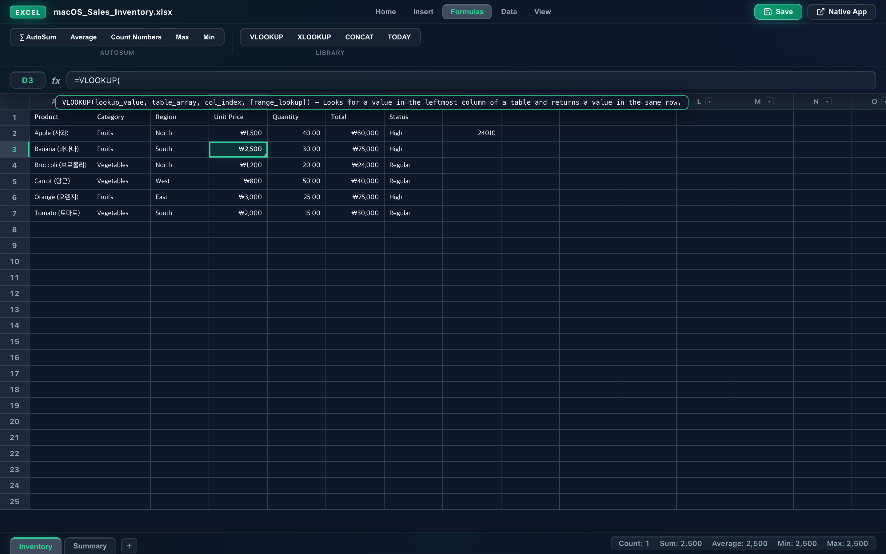
*▲ Figure 11: 수식 자동완성 박스 및 매개변수 시그니처 힌트 툴팁 (=VLOOKUP()*

- **조회/참조**: `VLOOKUP`, `XLOOKUP`, `HLOOKUP`, `INDEX`, `MATCH`, `CHOOSE`
- **조건부 연산**: `SUMIF`, `COUNTIF`, `AVERAGEIF`, `IFERROR`, `IFS`
- **통계/수학**: `SUM`, `AVERAGE`, `COUNT`, `COUNTA`, `MAX`, `MIN`, `ROUND`, `ROUNDUP`, `ROUNDDOWN`
- **텍스트/날짜**: `CONCAT`, `LEFT`, `RIGHT`, `MID`, `LEN`, `TRIM`, `TODAY`, `NOW`, `DATE`

---

## 📊 10. 인터랙티브 차트 시각화 (Charts)

데이터 범위를 드래그한 후 Insert 탭의 차트 버튼을 클릭하면 고해상도 HTML5 Canvas 차트 모달이 나타납니다.

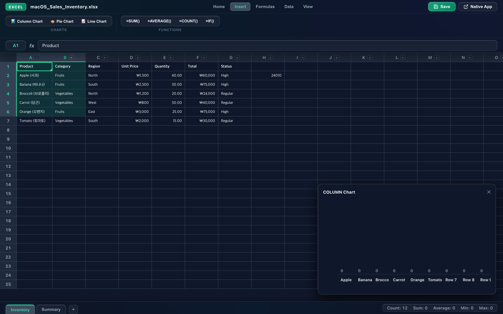
*▲ Figure 12: Insert 탭 및 Canvas 인터랙티브 막대 차트(Column Chart) 모달 오버레이*

- **클러스터 컬럼 차트**: 항목별 수치 비교 막대 그래프
- **파이 차트 (Pie Chart)**: 비중 및 점유율 원형 차트
- **실시간 반응형**: 데이터 선택 영역에 맞춰 차트가 동적으로 생성됩니다.

---

## 🔎 11. 전역 찾기 및 바꾸기 (Find & Replace)

- **검색 실행**: `Ctrl + F` / `Cmd + F`
- **바꾸기 실행**: `Ctrl + H` / `Cmd + H`

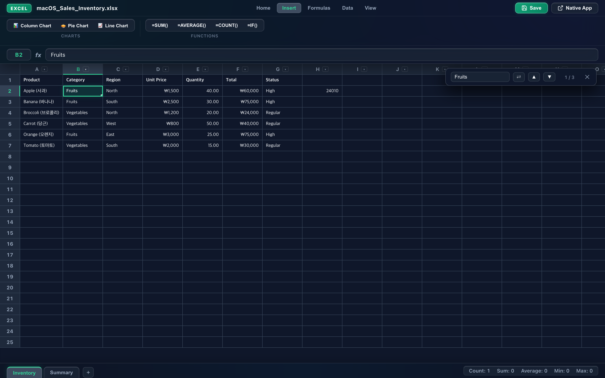
*▲ Figure 13: 전역 플로팅 글래스 검색바 (실시간 일치 건수 카운터 & 순차 탐색)*

- 실시간 매칭 카운터(`1 of 3`)와 함께 일치하는 셀이 에메랄드로 하이라이트됩니다.
- 단일 바꾸기(Replace) 및 일괄 바꾸기(Replace All)를 완벽 지원합니다.

---

## 📑 12. 다중 워크시트 관리 (Multi-Sheet Tabs)

하단 탭 바에서 여러 시트를 자유자재로 관리할 수 있습니다.

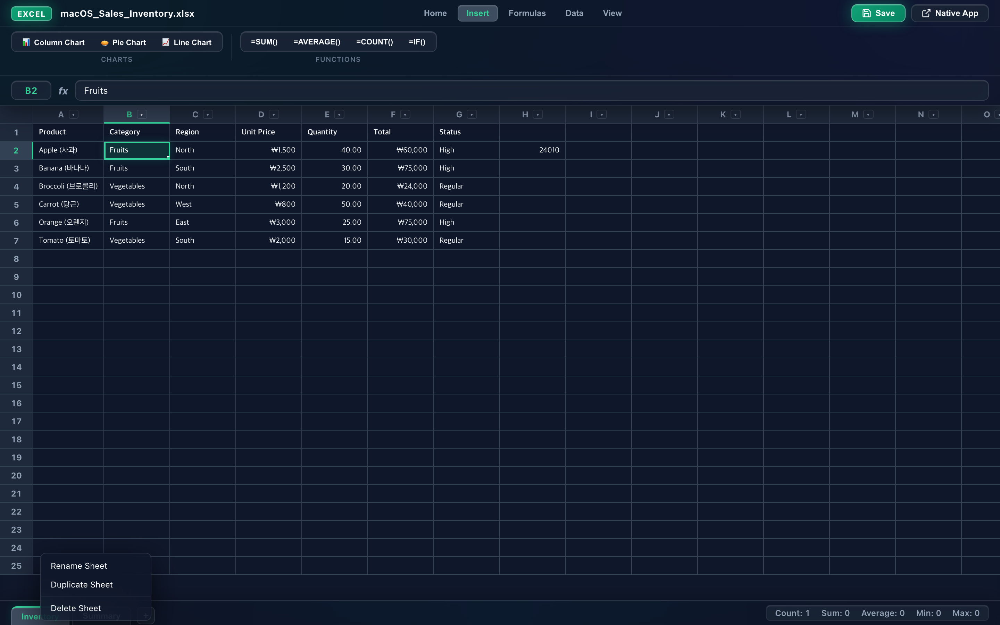
*▲ Figure 14: 하단 시트 탭 바 — 탭 더블클릭 이름 변경 및 우클릭 컨텍스트 메뉴*

- **새 시트 추가**: 우측 `+` 버튼 클릭.
- **이름 바꾸기**: 탭을 더블클릭하여 인라인 텍스트로 즉시 수정.
- **시트 메뉴**: 탭 우클릭 시 `Rename Sheet`, `Duplicate Sheet`, `Delete Sheet` 팝업.

---

## 📈 13. 다중 셀 범위 선택 및 상태바 실시간 통계 (Status Bar)

마우스로 다중 셀 범위를 사각형으로 드래그하면 선택 영역이 강조되며, 하단 상태 표시줄에 즉시 통계가 집계됩니다.

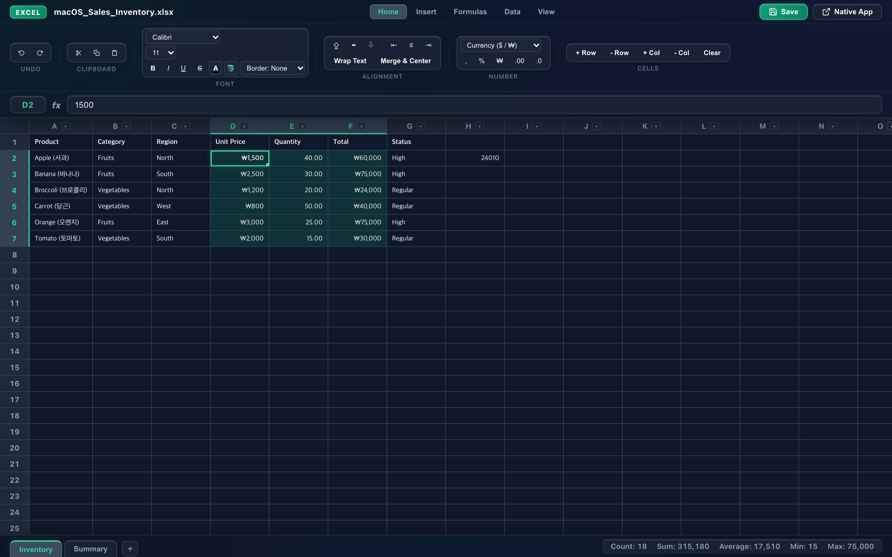
*▲ Figure 15: 다중 셀 사각형 드래그 선택 및 상태 표시줄 실시간 통계 (Count, Sum, Avg, Min, Max)*

- **Count**: 선택된 비어있지 않은 셀 개수
- **Sum**: 숫자 셀의 총합계 (천 단위 쉼표 포맷)
- **Average**: 숫자 셀의 산술 평균
- **Min / Max**: 범위 내 최소값 및 최대값

---

## ⚡️ 14. 초고속 네이티브 데스크톱 앱 연동 (Metal / DirectX)

대용량 엑셀 파일이나 극한의 연산 속도가 필요할 때, 리본바의 **Native App** 버튼을 누르면 즉시 독립 실행 네이티브 창으로 전환됩니다.

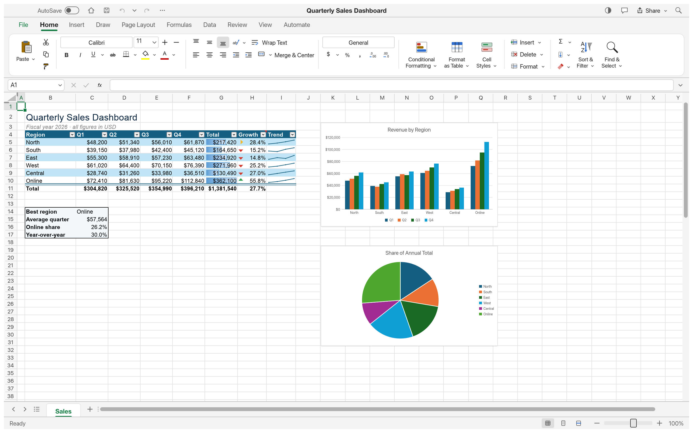
*▲ Figure 16: macOS Metal 122.38 FPS 고해상도(2880x1800) 네이티브 대시보드 렌더링*

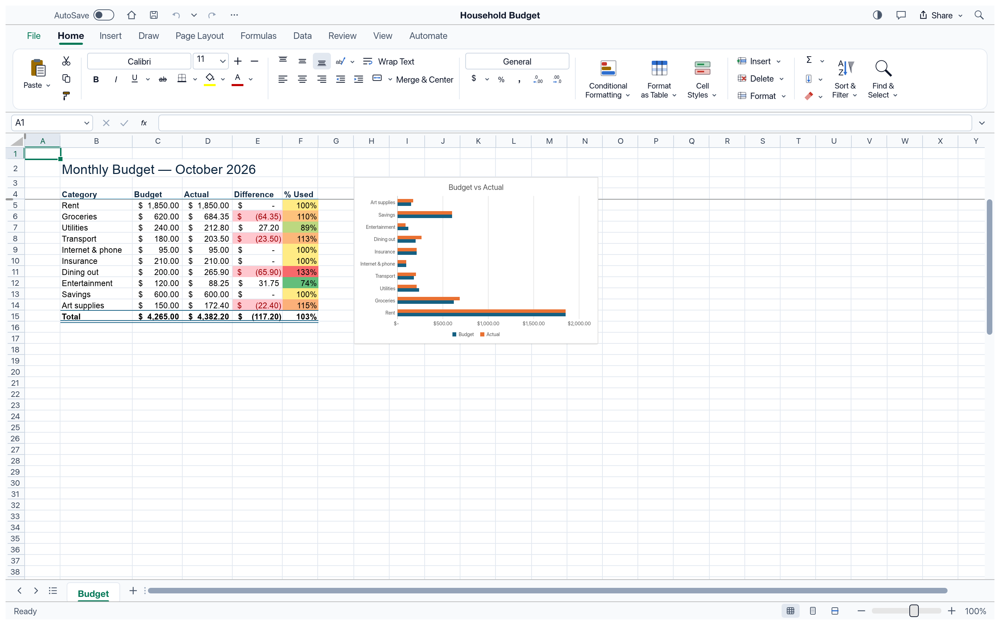
*▲ Figure 17: 월별 가계부 및 예산 집계 네이티브 렌더링 화면*

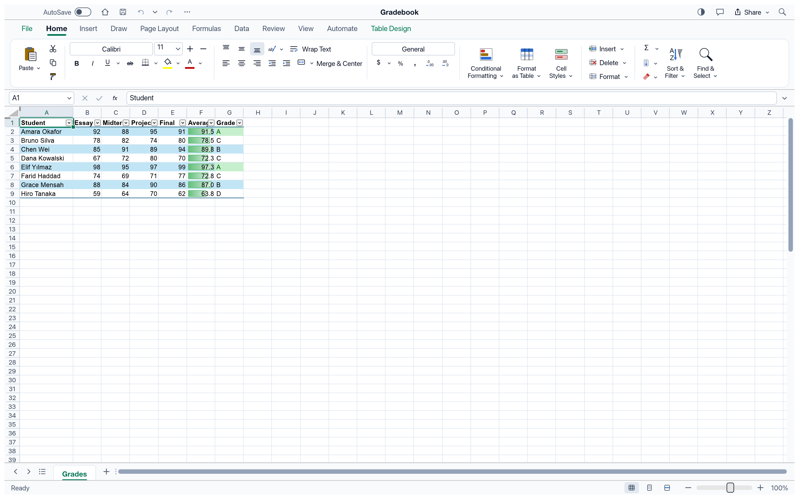
*▲ Figure 18: 학생 성적표 및 GPA 통계 분석 네이티브 렌더링 화면*

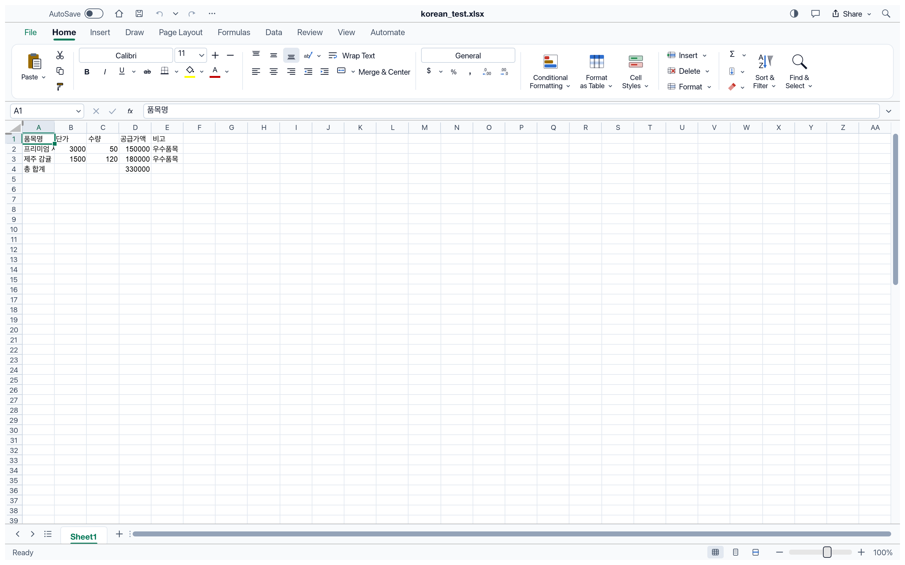
*▲ Figure 19: 한글 품목명 및 수식 연산 렌더링 (korean_test.xlsx)*

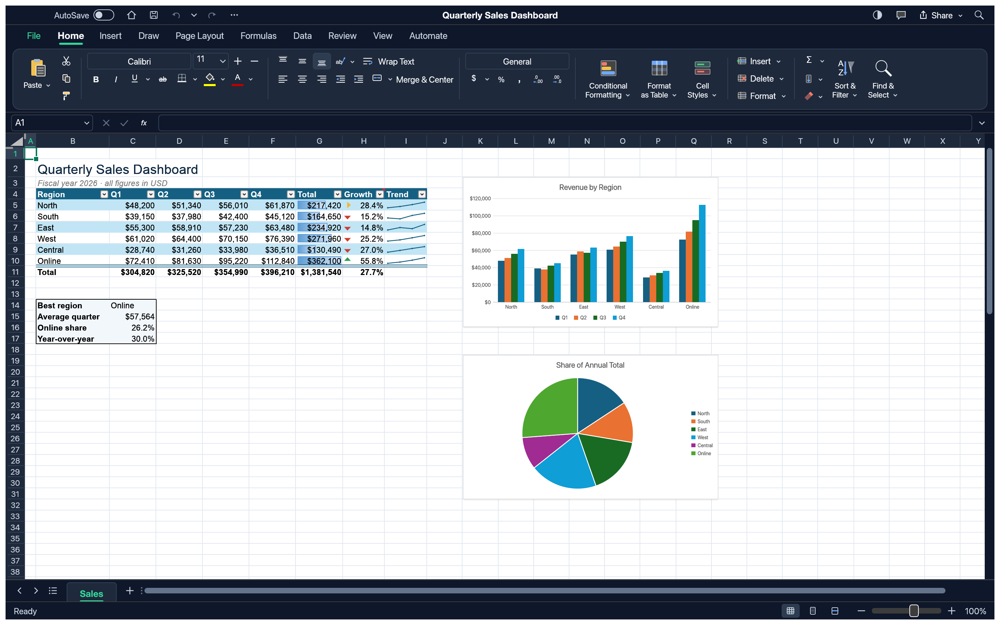
*▲ Figure 20: Slate-900 딥 다크 모드 렌더링 화면*

---

## ⌨️ 15. 단축키 레퍼런스 일람표 (Keyboard Shortcuts)

| 단축키 (Windows) | 단축키 (macOS) | 동작 설명 |
| :--- | :--- | :--- |
| `Ctrl + S` | `Cmd + S` | 현재 통합 문서 `.xlsx` 파일로 저장 |
| `Ctrl + Z` | `Cmd + Z` | 이전 작업 실행 취소 (Undo) |
| `Ctrl + Y` | `Cmd + Y` / `Cmd + Shift + Z` | 취소한 작업 다시 실행 (Redo) |
| `Ctrl + C` | `Cmd + C` | 선택 영역 클립보드 복사 |
| `Ctrl + V` | `Cmd + V` | 클립보드 내용 붙여넣기 |
| `Ctrl + X` | `Cmd + X` | 선택 영역 잘라내기 |
| `Ctrl + F` | `Cmd + F` | 전역 찾기 (Find) 플로팅 바 열기 |
| `Ctrl + H` | `Cmd + H` | 전역 바꾸기 (Replace) 플로팅 바 열기 |
| `Ctrl + B` | `Cmd + B` | 글꼴 굵게(Bold) 토글 |
| `Ctrl + I` | `Cmd + I` | 글꼴 기울임(Italic) 토글 |
| `Delete` / `Backspace` | `Delete` | 선택 영역 내용 지우기 |
| `F2` | `F2` | 수식 입력줄(`fx`)로 직접 포커스 이동 |
| `Enter` | `Enter` | 수식 입력 커밋 및 아래 셀로 이동 |
| `Tab` | `Tab` | 수식 입력 커밋 및 우측 셀로 이동 |
| `Shift + 화살표` | `Shift + 화살표` | 방향키로 사각형 선택 영역 확장 |

---

## 📚 16. 연관 검증 및 기술 문서

- [기술 감사 및 성능·기능 개선 종합 보고서 (docs/AUDIT_AND_IMPROVEMENT_REPORT.md)](AUDIT_AND_IMPROVEMENT_REPORT.md)
- [기능명세서 및 패리티 매트릭스 (docs/EXCEL_SPECIFICATION.md)](EXCEL_SPECIFICATION.md)
- [QA 심층 실물 검증 보고서 (docs/QA_PROOF.md)](QA_PROOF.md)
